<picture>
  <source media="(prefers-color-scheme: dark)" srcset="assets/dark/header.svg">
  
</picture>

  <a href="https://www.linkedin.com/in/davidjfunesgabaldon"><picture><source media="(prefers-color-scheme: dark)" srcset="assets/dark/btn-linkedin.svg"></picture></a>
  <a href="mailto:djfuga0@gmail.com"><picture><source media="(prefers-color-scheme: dark)" srcset="assets/dark/btn-email.svg"></picture></a>

<picture>
  <source media="(prefers-color-scheme: dark)" srcset="assets/dark/sec-about.svg">
  
</picture>

Data Systems Engineering student at **ETSIT-UPM**.

Where I like to be: **data engineering**, **cloud**, **machine learning** and **AI**.

<picture>
  <source media="(prefers-color-scheme: dark)" srcset="assets/dark/divider-heart.svg">
  
</picture>

<picture>
  <source media="(prefers-color-scheme: dark)" srcset="assets/dark/sec-work.svg">
  
</picture>

  <a href="https://github.com/djfuga/flight-delay-streaming-pipeline"><picture><source media="(prefers-color-scheme: dark)" srcset="assets/dark/pipeline.svg"></picture></a>
  <a href="https://github.com/djfuga/Traduccion-Imagenes-Satelite-PASD"><picture><source media="(prefers-color-scheme: dark)" srcset="assets/dark/pix2pix.svg"></picture></a>

<picture>
  <source media="(prefers-color-scheme: dark)" srcset="assets/dark/divider-quill.svg">
  
</picture>

<picture>
  <source media="(prefers-color-scheme: dark)" srcset="assets/dark/sec-projects.svg">
  
</picture>

<picture>
  <source media="(prefers-color-scheme: dark)" srcset="assets/dark/projects.svg">
  
</picture>

<picture>
  <source media="(prefers-color-scheme: dark)" srcset="assets/dark/divider-stars.svg">
  
</picture>

<picture>
  <source media="(prefers-color-scheme: dark)" srcset="assets/dark/sec-stack.svg">
  
</picture>

<picture>
  <source media="(prefers-color-scheme: dark)" srcset="assets/dark/stack.svg">
  
</picture>

<picture>
  <source media="(prefers-color-scheme: dark)" srcset="assets/dark/divider-staff.svg">
  
</picture>

<picture>
  <source media="(prefers-color-scheme: dark)" srcset="assets/dark/footer.svg">
  
</picture>

