  
  &nbsp;&nbsp;
  


Data Systems Engineering student at **ETSIT-UPM**.

Where I like to be: **data engineering**, **cloud**, **machine learning** and **AI**.


  <a href="https://github.com/djfuga/flight-delay-streaming-pipeline"></a>
  <a href="https://github.com/djfuga/Traduccion-Imagenes-Satelite-PASD"></a>






